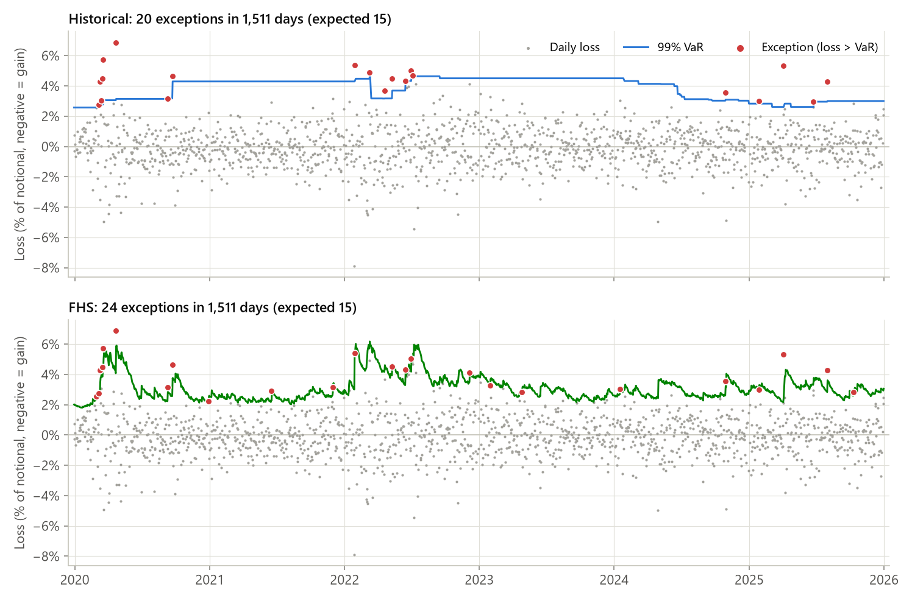
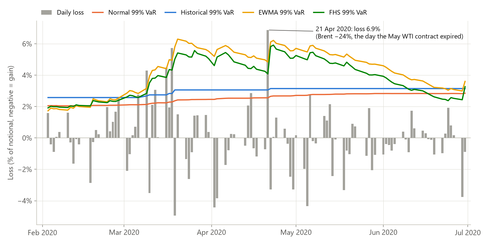
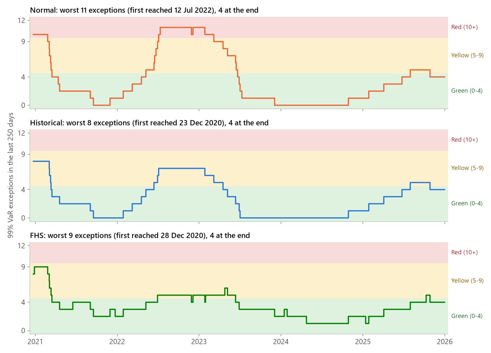
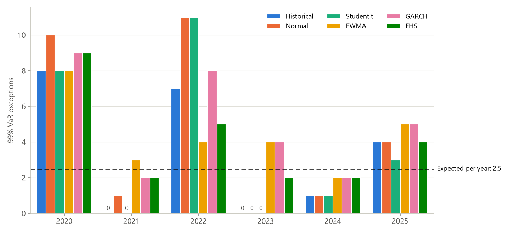
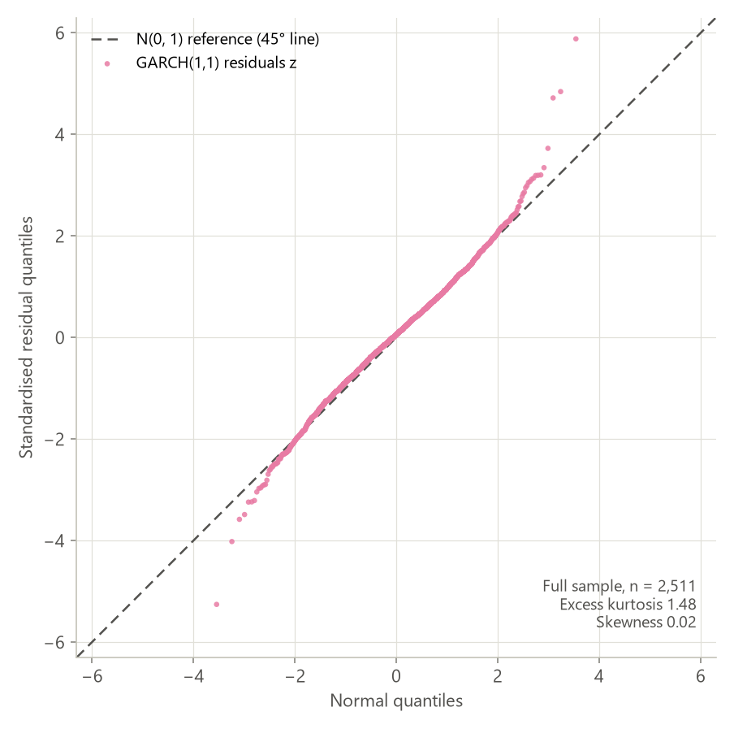

# Market Risk for a Commodity Portfolio: VaR, Expected Shortfall & Backtesting

One-day 99% and 97.5% Value at Risk (VaR) and Expected Shortfall (ES) for a USD 10m,
equal-weight, long-only portfolio of five commodity futures. Six models are compared:
historical simulation, normal, Student t, EWMA, GARCH(1,1) and filtered historical
simulation (FHS). The GARCH is estimated by hand with maximum likelihood and validated
against the `arch` package. All models are backtested out of sample over 1,511 trading days
(2019-12-30 to 2025-12-31), which include the COVID crash and the 2022 energy shock.

## Key findings

- **FHS is the most balanced model at 99%.** It never reaches the red zone, passes conditional
  coverage (p = 0.074) and spreads its exceptions across years (9, 2, 5, 2, 2, 4 from 2020 to
  2025). Historical simulation has fewer exceptions in total (20), but partly by compensation:
  it misses in crises and has none in 2021 and 2023 (see the ghost effect below).
- **No model wins on every test.** At 99%, exceptions against 15.1 expected:
  historical 20, Student t 23, FHS 24, EWMA 26, normal 27, GARCH 30.
  Only historical and Student t pass Kupiec at 5%. At 97.5% the picture flips: the
  fixed-window models fail Christoffersen independence (p = 0.001-0.029), while EWMA, GARCH
  and FHS pass it (p > 0.9) but have too many exceptions (53-56 against 37.8).
- **Historical simulation has a ghost effect.** Its 99% VaR stayed at 4.30% every day of 2021
  and at 4.51% every day of 2023, held up by 2020 and 2022 losses still inside the 500-day
  window. It had 0 exceptions in both years (2.5 expected). FHS averaged 2.53% and 2.91%, so
  historical VaR was 1.77 and 1.59 points higher: about USD 177k and USD 159k of extra 99% VaR
  on USD 10m in calm years.
- **The normal model reaches the Basel red zone.** It peaked at 11 exceptions in 250 days
  (first reached 2022-07-12). Student t also reached 11 (2022-12-05). Historical, EWMA,
  GARCH and FHS stayed at or below 9 (yellow).
- **No model covered the 2020-04-21 loss.** The portfolio lost 6.88% that day. The 99% VaR
  for that day ranged from 2.56% (normal) to 4.84% (EWMA).
- **GARCH explains about half of the fat tails.** Excess kurtosis falls from 2.78 for daily
  portfolio returns to 1.48 for the GARCH standardised residuals. The residuals still have fat
  tails. FHS reduces the 99% Z2 from 1.17 (normal GARCH) to 0.71, just above the approximate
  0.70 threshold.

## Data and portfolio

| Ticker | Contract | Weight |
|---|---|---|
| BZ=F | Brent crude oil | 20% |
| NG=F | Henry Hub natural gas | 20% |
| GC=F | Gold | 20% |
| HG=F | Copper | 20% |
| ZW=F | Chicago wheat | 20% |

- **Positions:** long only, notional USD 10,000,000, rebalanced daily to equal weights, so the
  portfolio return is the weighted sum of the asset returns.
- **Data:** Yahoo Finance front-month continuous futures, daily closes from 2016-01-04 to
  2025-12-31. They are taken from the DuckDB database built in
  [commodity-sql-analytics](https://github.com/BallesJr/commodity-sql-analytics) and saved in
  `data/prices_close.csv`.
- **Common dates and returns:** only the 2,512 dates on which all five contracts have a price
  are kept. That gives 2,511 simple daily returns, from 2016-01-05 to 2025-12-31.
- **WTI (CL=F) is excluded.** Its front-month series closed at USD -37.63 on 2020-04-20, the day
  before the May 2020 contract expired. Simple and log returns are undefined across a negative
  price.
- **Roll adjustment:** the `=F` series are **not adjusted for rolls**. On a roll date, the close
  moves from one contract to the next.

## Methods

Losses are positive: $L_t = -r_t$. VaR and ES are reported as positive fractions of notional.
Parametric models assume a zero mean. $\alpha \in \lbrace 0.99, 0.975 \rbrace$.

| Method | Return distribution | Volatility |
|---|---|---|
| Historical | Empirical, last 500 returns | None (window only) |
| Normal | Normal | Sample std, last 500 returns |
| Student t | Student t (MLE, location 0) | Fitted scale, last 500 returns |
| EWMA | Normal | EWMA, λ = 0.94, last 500 returns |
| GARCH | Normal | GARCH(1,1), all returns to date |
| FHS | Empirical GARCH residuals | GARCH(1,1), all returns to date |

**Definitions.**

$$\mathrm{VaR}_\alpha = \inf \lbrace \ell : P(L \le \ell) \ge \alpha \rbrace, \qquad
\mathrm{ES}_\alpha = \mathbb{E}\left[L \mid L \ge \mathrm{VaR}_\alpha\right]$$

**Historical.** With losses sorted in descending order, $L_{(1)} \ge L_{(2)} \ge \dots$, and
$k = \lceil n(1-\alpha) \rceil$ (computed with rounding to avoid floating-point error, so that
$n = 500$ and $\alpha = 0.99$ give $k = 5$):

$$\mathrm{VaR} = L_{(k)}, \qquad \mathrm{ES} = \frac{1}{k}\sum_{i=1}^{k} L_{(i)}$$

**Normal** (also used by EWMA and GARCH with their own $\sigma$), where $z_\alpha = \Phi^{-1}(\alpha)$:

$$\mathrm{VaR} = \sigma z_\alpha, \qquad \mathrm{ES} = \sigma \frac{\varphi(z_\alpha)}{1-\alpha}$$

**Student t**, with scale $s$ (not the standard deviation), $\nu > 1$ and $q = t_\nu^{-1}(\alpha)$:

$$\mathrm{VaR} = s\thinspace q, \qquad \mathrm{ES} = s\thinspace \frac{f_\nu(q)}{1-\alpha}\thinspace \frac{\nu + q^2}{\nu - 1}$$

**EWMA:** $\sigma^2_{t+1} = \lambda \sigma^2_t + (1-\lambda) r_t^2$, with $\lambda = 0.94$. The
recursion starts from the sample variance of the first 30 returns in the window.

**GARCH(1,1)**, fitted on returns in percent by Gaussian maximum likelihood with SLSQP, under
$\omega > 0$, $\alpha_1, \beta_1 \ge 0$ and $\alpha_1 + \beta_1 < 1$. The pre-sample value
(backcast) is computed the same way as in `arch`.

$$\sigma_t^2 = \omega + \alpha_1 r_{t-1}^2 + \beta_1 \sigma_{t-1}^2, \qquad
\ell = -\tfrac{1}{2}\sum_t \left(\ln 2\pi + \ln \sigma_t^2 + r_t^2/\sigma_t^2\right)$$

On the full sample: $\alpha_1 = 0.047$, $\beta_1 = 0.944$, persistence 0.991, shock half-life
75.4 days, long-run volatility 19.8% a year.

**FHS.** Standardise each return by its GARCH volatility, take the historical VaR and ES of the
residuals, and scale them by the next-day volatility forecast:

$$z_t = \frac{r_t}{\sigma_t}, \qquad \mathrm{VaR} = \sigma_{T+1}\thinspace \mathrm{VaR}^{\text{hist}}_\alpha(z), \qquad
\mathrm{ES} = \sigma_{T+1}\thinspace \mathrm{ES}^{\text{hist}}_\alpha(z)$$

## Backtesting setup

- **Period:** the first forecast is made once 1,000 returns are available. The backtest runs
  from 2019-12-30 to 2025-12-31 (1,511 days).
- **No look-ahead:** the forecast for day $t$ uses returns up to $t-1$ only.
- **Estimation windows:**
  - Historical, normal, Student t and EWMA use the last 500 returns.
  - GARCH and FHS use an expanding window. Parameters are re-estimated every 20 trading days;
    in between, $\sigma_t$ is updated daily with the latest parameters.
- **Tests**, with exceptions defined as $I_t = \mathbf{1}_{\lbrace L_t > \mathrm{VaR}_t \rbrace}$:
  - **Kupiec POF:** likelihood ratio test that the exception rate equals $1-\alpha$
    (χ²(1)). Zero counts are handled with $0 \ln 0 = 0$.
  - **Christoffersen:** independence test on the first-order Markov transition counts
    (χ²(1)), and conditional coverage $LR_{cc} = LR_{pof} + LR_{ind}$ (χ²(2)).
  - **Basel traffic light:** 99% exceptions counted over rolling 250-day windows. Green 0-4,
    yellow 5-9, red 10+.
  - **Acerbi-Székely Z2** for ES, with $T$ the number of backtest days:

    $$Z_2 = \frac{1}{T(1-\alpha)}\sum_t \frac{L_t I_t}{\mathrm{ES}_t} - 1$$

    It is 0 when the model is correct and positive when risk is underestimated. ES is rejected
    at about 5% when $Z_2 > 0.70$ (an approximate threshold from Acerbi and Székely, 2014).
  - **Loss / ES:** mean of $L_t / \mathrm{ES}_t$ on exception days. It should be close to 1.

## Results

### Backtest summary

p-values below 0.05 reject. Z2 above 0.70 rejects ES. L/ES is the mean realised loss over
predicted ES on exception days.

**99% (1,511 days, 15.1 exceptions expected)**

| Method | Exceptions | Rate | Kupiec p | Ind. p | CC p | Z2 | L/ES | Worst Basel zone | Final zone |
|---|---:|---:|---:|---:|---:|---:|---:|---|---|
| Historical | 20 | 1.32% | 0.228 | 0.265 | 0.260 | 0.48 | 1.12 | yellow (8), 2020-12-23 | green (4) |
| Normal | 27 | 1.79% | 0.006 | 0.506 | 0.017 | 1.29 | 1.28 | red (11), 2022-07-12 | green (4) |
| Student t | 23 | 1.52% | 0.058 | 0.360 | 0.109 | 0.52 | 1.00 | red (11), 2022-12-05 | green (3) |
| EWMA | 26 | 1.72% | 0.011 | 0.468 | 0.029 | 0.88 | 1.09 | yellow (8), 2020-12-28 | yellow (5) |
| GARCH | 30 | 1.99% | 0.001 | 0.141 | 0.001 | 1.17 | 1.09 | yellow (9), 2020-12-28 | yellow (5) |
| FHS | 24 | 1.59% | 0.034 | 0.395 | 0.074 | 0.71 | 1.07 | yellow (9), 2020-12-28 | green (4) |

**97.5% (1,511 days, 37.8 exceptions expected)**

| Method | Exceptions | Rate | Kupiec p | Ind. p | CC p | Z2 | L/ES |
|---|---:|---:|---:|---:|---:|---:|---:|
| Historical | 42 | 2.78% | 0.494 | 0.029 | 0.074 | 0.24 | 1.11 |
| Normal | 43 | 2.85% | 0.399 | 0.001 | 0.003 | 0.43 | 1.26 |
| Student t | 39 | 2.58% | 0.841 | 0.019 | 0.061 | 0.12 | 1.08 |
| EWMA | 53 | 3.51% | 0.018 | 0.916 | 0.060 | 0.51 | 1.08 |
| GARCH | 56 | 3.71% | 0.005 | 0.956 | 0.020 | 0.61 | 1.09 |
| FHS | 56 | 3.71% | 0.005 | 0.956 | 0.020 | 0.54 | 1.04 |

Full table: `results/backtest_summary.csv`. Daily forecasts: `results/backtest_forecasts.csv`.

### Figures


*Historical VaR moves in long flat steps; FHS VaR tracks volatility (99%, exceptions in red).*


*February to June 2020: EWMA and FHS rise to 5.9-6.3% while normal and historical stay below 3.2%.*


*Rolling 250-day 99% exception counts for three models: normal enters the red zone, historical and FHS do not.*


*99% exceptions per year against 2.5 expected: excess in 2020 and 2022, few or none in 2021 and 2023.*


*GARCH standardised residuals against the normal: both tails are fatter than normal.*

### Crisis and calm periods

99% VaR exceptions by sub-period (`results/crisis_summary.csv`). The periods are short, so no
p-values are reported: the tests have almost no power with 1-2.5 expected exceptions.

| Period | Days | Expected | Historical | Normal | Student t | EWMA | GARCH | FHS |
|---|---:|---:|---:|---:|---:|---:|---:|---:|
| COVID, 2020-02-20 to 2020-06-30 | 92 | 0.92 | 6 | 8 | 7 | 5 | 6 | 6 |
| Energy, 2022-02-24 to 2022-12-30 | 215 | 2.15 | 6 | 10 | 10 | 4 | 7 | 4 |
| Calm, 2021 | 252 | 2.52 | 0 | 1 | 0 | 3 | 2 | 2 |
| Calm, 2023 | 250 | 2.50 | 0 | 0 | 0 | 4 | 4 | 2 |

- **COVID:**
  - EWMA 99% VaR peaked 21 trading days in, at 6.30% on 2020-03-20. GARCH and FHS peaked on
    2020-04-23, at 5.74% and 5.92%.
  - Normal and Student t VaR peaked on the last day of the period, at 2.85% and 3.67%. Their
    losses on exception days were 1.56 and 1.15 times the predicted ES.
- **2022 energy shock:**
  - EWMA, GARCH and FHS VaR peaked on 2022-03-10, 10 trading days in.
  - EWMA and FHS had 4 exceptions; normal and Student t had 10 each.
- **Calm years:**
  - Historical VaR was constant (4.30% in 2021, 4.51% in 2023), with no exceptions.
  - EWMA, GARCH and FHS had 2-4 exceptions per year. Their loss/ES ratio was between 0.87
    and 1.06.

## Validation

- **GARCH against `arch`:**
  - At fixed parameters, the log-likelihood matches `arch` to within 1e-8 (three parameter
    sets) and the conditional variances match with a relative tolerance of 1e-10.
  - Full-sample MLE: the parameters differ from `arch` by at most 2.4e-7 and the
    log-likelihood is identical to 8 decimals (-3907.52666088). The conditional volatility
    series differ by at most 3.5e-6 (in % units). Last 500 days: the largest parameter
    difference is 1.4e-4.
  - Simulated GARCH(1,1) with ω = 0.02, α₁ = 0.08, β₁ = 0.90 (5,000 observations): the
    parameters are recovered within the test tolerances.
- **Ljung-Box (10 lags, full sample):**
  - Squared returns: Q = 394.5, p < 0.001.
  - Squared GARCH residuals: Q = 5.87, p = 0.83.
  - So the filter removes the volatility clustering.
- **Date alignment:**
  - Changing returns from day $t$ onwards leaves every forecast up to day $t$ unchanged, for
    all six methods.
  - Changing only the return of day $t-1$ moves the EWMA, GARCH and FHS forecasts for day $t$, so
    the most recent observation is used.
- **Other checks:**
  - Returns match the `ret` column of the source DuckDB view on gap-free dates.
  - Kupiec reproduces the textbook values (T = 250, p = 0.01: x = 7 gives LR = 5.50, x = 6
    gives LR = 3.56).
  - Z2 is close to 0 for a correctly specified normal model.
- **Test suite:** 78 pytest tests, all passing.

## Limitations

- **Roll-unadjusted prices.** Front-month `=F` series jump at contract rolls, which can create
  returns that no held position earned.
- **Not investable returns.** The returns are close-to-close changes of a continuous series.
  They ignore roll costs and carry, so they do not equal the return of an investable futures
  position.
- **Univariate model.** VaR is computed on the portfolio return series, not from asset-level
  volatilities and correlations, so it gives no risk decomposition.
- **Zero mean.** All parametric models assume a zero daily mean.
- **GARCH refits every 20 days.** Between refits, the parameters are held fixed.
- **Approximate Z2 threshold.** 0.70 is an approximate critical value, not one simulated for
  this data.
- **Scope.** The results come from one portfolio, one set of weights and one sample period
  (2016-2025).

## Project structure

```
data/prices_close.csv        close prices, one column per contract (snapshot)
src/config.py                tickers, weights, notional, levels, windows, periods, paths
src/data.py                  loading, date alignment, returns, portfolio P&L
src/models.py                historical, normal, Student t, EWMA, GARCH, FHS VaR/ES
src/garch.py                 GARCH(1,1) MLE, backcast, forecast, Ljung-Box
src/backtest.py              rolling forecasts, Kupiec, Christoffersen, Basel, Z2
src/periods.py               crisis / calm sub-period statistics
src/reporting.py             shared VaR/ES table
scripts/export_data.py       DuckDB -> data/prices_close.csv
scripts/latest_var.py        next-day VaR/ES from the last 500 days
scripts/fit_garch.py         GARCH fit compared with arch
scripts/fhs_diagnostics.py   Ljung-Box, residual moments, FHS vs GARCH
scripts/run_backtest.py      backtest -> results/backtest_*.csv
scripts/crisis_comparison.py sub-periods -> results/crisis_summary.csv
scripts/make_figures.py      figures -> results/figures/
tests/                       pytest suite
```

## How to reproduce

Tested with Python 3.12. Package versions are pinned in `requirements.txt`.

```bash
python -m venv .venv
.venv\Scripts\activate            # Windows; on macOS/Linux: source .venv/bin/activate
pip install -r requirements.txt

# Optional: data/prices_close.csv is already in the repo. Only rebuild it if you have the
# DuckDB database from commodity-sql-analytics.
python scripts/export_data.py --db path/to/commodities.duckdb

python scripts/latest_var.py
python scripts/fit_garch.py
python scripts/fhs_diagnostics.py
python scripts/run_backtest.py       # about 35 s; writes results/backtest_*.csv
python scripts/crisis_comparison.py  # reads results/backtest_forecasts.csv
python scripts/make_figures.py       # reads results/backtest_forecasts.csv
pytest
```

The test that compares returns with the DuckDB view is skipped when the database is not
available.

## References

- Acerbi, C. and Székely, B. (2014). Backtesting Expected Shortfall. *Risk*, December 2014.
- Barone-Adesi, G., Giannopoulos, K. and Vosper, L. (1999). VaR without correlations for
  portfolios of derivative securities. *Journal of Futures Markets*, 19(5), 583-602.
- Basel Committee on Banking Supervision (2019). *Minimum capital requirements for market risk*
  (Fundamental Review of the Trading Book). Bank for International Settlements.
- Bollerslev, T. (1986). Generalized autoregressive conditional heteroskedasticity.
  *Journal of Econometrics*, 31(3), 307-327.
- Christoffersen, P. (1998). Evaluating interval forecasts. *International Economic Review*,
  39(4), 841-862.
- J.P. Morgan / Reuters (1996). *RiskMetrics - Technical Document*, 4th edition.
- Kupiec, P. (1995). Techniques for verifying the accuracy of risk measurement models.
  *Journal of Derivatives*, 3(2), 73-84.
